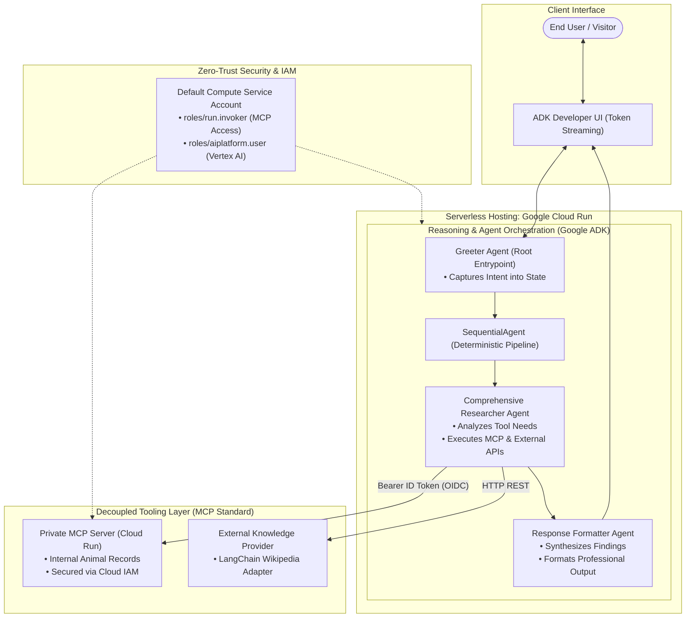

# Enterprise Agentic AI: Autonomous ADK Agent with Remote MCP Tooling on Cloud Run

[](https://cloud.google.com/run)
[](https://google.github.io/adk-docs/)
[](https://modelcontextprotocol.io/)
[]()

> **Enterprise Architecture Showcase**: An autonomous multi-agent assistant built with the **Google Agent Development Kit (ADK)**, utilizing the **Model Context Protocol (MCP)** to securely decouple the reasoning layer from private enterprise data microservices, containerized and deployed serverlessly to **Google Cloud Run**.

---

## 📌 Executive Summary & Business Value

Modern enterprise AI initiatives fail when LLM reasoning logic is tightly coupled to internal databases, APIs, and business tooling. This repository demonstrates the **industry standard solution**:

1. **Separation of Concerns**: The LLM reasoning layer (ADK Agent) is strictly separated from the operational tooling layer (MCP Server). Domain microservices can evolve independently without breaking agent logic.
2. **Zero-Trust IAM Security**: Private microservices require service-to-service authentication. The agent dynamically retrieves short-lived Google OAuth2 ID tokens scoped to the target service audience (`roles/run.invoker`).
3. **Hybrid Information Synthesis**: The agent autonomously routes queries between **private proprietary data** (internal zoo database via MCP) and **public web knowledge** (LangChain Wikipedia adapter).
4. **Serverless & Cost-Optimized**: Hosted on Google Cloud Run with **0-to-N autoscaling** (true serverless: $0 at idle, scales instantly under surge demand).

---

## 🏛️ System Architecture



---

## 🧩 Agent Pipeline & Sequence

| Agent Stage | Role / Type | Responsibilities | Tool Access |
| :--- | :--- | :--- | :--- |
| **`greeter`** | Root `Agent` | Manages conversation intake, saves user query into memory context (`ToolContext.state["PROMPT"]`), and delegates to the workflow. | `add_prompt_to_state` |
| **`tour_guide_workflow`** | `SequentialAgent` | Deterministic pipeline coordinator executing worker agents in rigid order. | None (Coordinates sub-agents) |
| **`comprehensive_researcher`** | Specialist `Agent` | The system "brain". Evaluates query context: calls MCP if internal data is needed, calls Wikipedia if general knowledge is needed, or runs both concurrently. | `mcp_tools`, `wikipedia_tool` |
| **`response_formatter`** | Presentation `Agent` | Ingests `research_data` from shared state and crafts an engaging, customer-ready response. | None (Pure synthesis) |

---

## 🔒 Enterprise Security: Zero-Trust Token Exchange

Direct database or credential exposure is eliminated. Service-to-service communication is governed strictly by Google Cloud IAM:

```python
def get_id_token() -> str:
    """Fetch ephemeral OIDC ID token authenticated to the MCP Cloud Run service."""
    target_url = os.getenv("MCP_SERVER_URL")
    # Base service URL without path is the required token audience
    audience = target_url.split('/mcp/')[0]
    auth_request = google.auth.transport.requests.Request()
    return google.oauth2.id_token.fetch_id_token(auth_request, audience)

mcp_tools = MCPToolset(
    connection_params=StreamableHTTPConnectionParams(
        url=mcp_server_url,
        headers={"Authorization": f"Bearer {get_id_token()}"},
    ),
)
```

---

## 📂 Repository Structure

```text
GCP/01-adk-mcp-cloudrun-agent/
├── README.md                           # Master executive and technical showcase
├── lab_notes.md                        # Step-by-step notes & runtime troubleshooting log
├── .gitignore                          # Standard Python / GCP ignore rules
├── zoo_guide_agent/
│   ├── __init__.py                     # Package entry point
│   ├── agent.py                        # ADK Multi-Agent implementation & MCP toolset
│   ├── requirements.txt                # Pinned production dependencies
│   └── .env.example                    # Environment configuration template
├── docs/
│   └── architecture.md                 # In-depth architectural whitepaper
└── scripts/
    └── deploy.sh                       # One-touch automated Cloud Run deployment script
```

---

## 🚀 Reproduction & Deployment Guide

### Prerequisites
- Google Cloud Project with Billing enabled
- Google Cloud Shell or `gcloud` CLI installed locally
- Python 3.10+

### Step 1: Enable Cloud Services & Install Dependencies
```bash
gcloud services enable \
  run.googleapis.com \
  artifactregistry.googleapis.com \
  cloudbuild.googleapis.com \
  aiplatform.googleapis.com \
  compute.googleapis.com

cd zoo_guide_agent
pip3 install -r requirements.txt --user
export PATH=$PATH:~/.local/bin
```

### Step 2: Configure Environment & Service Identity
```bash
export PROJECT_ID=$(gcloud config get-value project)
export REGION=$(gcloud compute project-info describe --format="value(commonInstanceMetadata.items[google-compute-default-region])")
export PROJECT_NUMBER=$(gcloud projects describe $PROJECT_ID --format="value(projectNumber)")
export SERVICE_ACCOUNT="${PROJECT_NUMBER}-compute@developer.gserviceaccount.com"

# Grant IAM Permissions
gcloud projects add-iam-policy-binding $PROJECT_ID \
  --member="serviceAccount:$SERVICE_ACCOUNT" \
  --role="roles/run.invoker"

gcloud projects add-iam-policy-binding $PROJECT_ID \
  --member="serviceAccount:$SERVICE_ACCOUNT" \
  --role="roles/aiplatform.user"
```

### Step 3: Automated One-Touch Deployment
```bash
# Execute deployment script
chmod +x ../scripts/deploy.sh
../scripts/deploy.sh
```

---

## 🧪 Verification & Test Prompts

Once deployed to Cloud Run, open the generated service URL in your browser:

1. **Internal Private DB Query (MCP Tool Only)**:
   > *"Where are the penguins located in the zoo?"*
2. **External Knowledge Query (Wikipedia Tool Only)**:
   > *"What is the average lifespan of a penguin in the wild?"*
3. **Hybrid Cross-Synthesis Query (MCP + Wikipedia)**:
   > *"What species are the penguins in our zoo, and what do they typically eat in the wild?"*
   > *"Where are the lions and what do they eat in the wild?"*
4. **Boundary Condition (Item not in internal records)**:
   > *"Do we have polar bears in this zoo?"*

---

## 🏢 Business Applications for Enterprise Clients

The exact pattern demonstrated here directly maps to enterprise client modernization:
- **Workplace & Facilities Concierge**: Internal desk/room booking API (via MCP) + external transit/weather data.
- **IT & Operations Helpdesk**: Private Jira/ServiceNow ticketing microservice (via MCP) + public vendor documentation.
- **Enterprise HR Bot**: Secure employee database & internal handbook (via MCP) + external regulatory guidelines.
