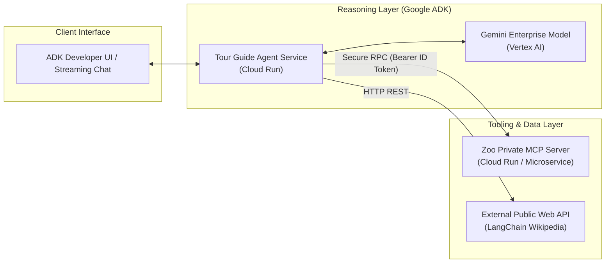
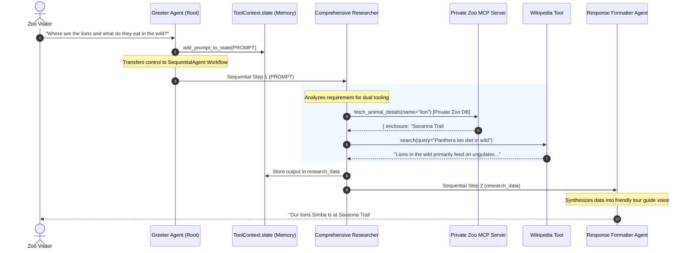

# Architecture Deep-Dive: Enterprise ADK & MCP Serverless Agent

This document provides a comprehensive technical overview of the multi-agent system architecture built using the **Google Agent Development Kit (ADK)**, the **Model Context Protocol (MCP)**, and **Google Cloud Run**.

---

## 1. Architectural Philosophy: Separation of Concerns

A classic anti-pattern in generative AI development is tightly coupling **LLM reasoning logic** with **data retrieval and internal tool execution**. 

In this architecture, we strictly decouple the **Reasoning Layer** from the **Tooling Layer**:



### Key Advantages of This Separation:
1. **Independent Lifecycle & Governance**: Tool APIs (MCP servers) can be maintained, upgraded, and monitored by domain/database engineering teams without touching prompt logic or agent code.
2. **Standardized Protocol**: MCP establishes a vendor-neutral protocol for exposing tools, schemas, and prompts to LLMs.
3. **Zero-Trust Security Boundary**: The LLM agent does not have direct access to database credentials or internal VPC storage. It only interacts with the MCP server over authenticated and authorized endpoints.

---

## 2. Multi-Agent Orchestration Flow

The solution leverages ADK's `SequentialAgent` and specialized roles to handle conversational flow, data gathering, and user presentation deterministically.



---

## 3. Enterprise Security & IAM Authentication

To connect to private Cloud Run services (such as the Zoo MCP server), the agent cannot use long-lived API keys. Instead, it relies on **Google Cloud Identity and Access Management (IAM)** and short-lived OpenID Connect (OIDC) ID tokens.

### Identity Flow
1. **Cloud Run Identity**: The agent runs under the default Compute Service Account:
   `${PROJECT_NUMBER}-compute@developer.gserviceaccount.com`
2. **MCP Authorization**: The service account is granted `roles/run.invoker` on the MCP server Cloud Run service.
3. **Token Fetching**:
   ```python
   def get_id_token():
       target_url = os.getenv("MCP_SERVER_URL")
       audience = target_url.split('/mcp/')[0]
       request = google.auth.transport.requests.Request()
       return google.oauth2.id_token.fetch_id_token(request, audience)
   ```
4. **Header Injection**: The token is passed as `Authorization: Bearer <ID_TOKEN>` within `MCPToolset(StreamableHTTPConnectionParams(...))`.
5. **Model Access**: The service account is granted `roles/aiplatform.user` to invoke Gemini models on Google Vertex AI.

---

## 4. Serverless Hosting on Google Cloud Run

Deploying with `adk deploy cloud_run` leverages Google Cloud Run's container infrastructure:

| Feature | Enterprise Benefit |
| :--- | :--- |
| **0-to-N Autoscaling** | Scales to zero when no visitors are chatting ($0 compute cost). Rapidly scales horizontally when thousands of visitors arrive. |
| **Streaming UI** | ADK builds in a token-streaming developer UI (`--with_ui`) with zero frontend setup required. |
| **Stateless Container** | Ephemeral containers prevent cross-session memory leaks; session memory is managed in `ToolContext.state`. |
| **Portability** | Standard Docker container packaged by Google Cloud Build into Artifact Registry, executable on any OCI-compliant runtime. |
