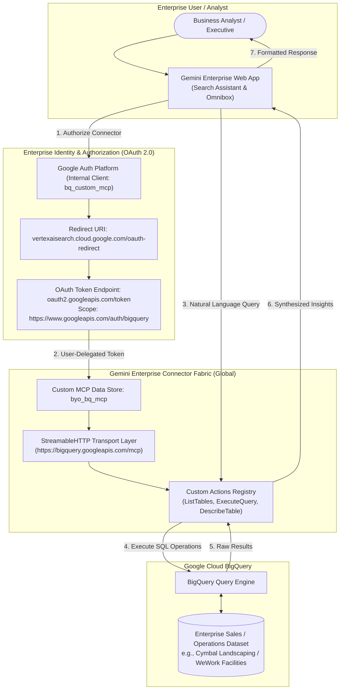

# Enterprise Gemini AI: Custom BigQuery MCP Server Data Store in Gemini Enterprise

[](https://cloud.google.com/gemini)
[](https://cloud.google.com/bigquery)
[](https://modelcontextprotocol.io/)
[]()

> **Enterprise Architecture Showcase**: Grounding **Gemini Enterprise** directly onto an enterprise **BigQuery Data Warehouse** using a **Custom Model Context Protocol (MCP) Server** with user-delegated OAuth 2.0 authentication, enabling conversational analytics without ETL pipelines.

---

## 📌 Executive Summary & Business Value

Enterprise decision-makers and business analysts need immediate answers from corporate data warehouses without waiting for SQL analysts to build custom dashboards. 

This implementation demonstrates how to integrate **Google Cloud BigQuery** into **Gemini Enterprise** via the **Custom Model Context Protocol (MCP)**:

1. **Zero-ETL Conversational Analytics**: No data copying, embedding pipelines, or vector databases. Gemini translates natural language into BigQuery operations in real time.
2. **Enterprise Security & Governance**: Enforces **OAuth 2.0 user delegation**. Queries execute under the authenticated user's Google Identity permissions, respecting existing BigQuery row-level and column-level security policies.
3. **StreamableHTTP MCP Standard**: Connects Gemini Enterprise to Google's hosted BigQuery MCP endpoint (`https://bigquery.googleapis.com/mcp`) using the high-performance StreamableHTTP transport protocol.
4. **Dynamic Tool & Action Enablement**: Discover and enable BigQuery actions dynamically (`ListTables`, `ExecuteQuery`, `DescribeTable`) within the Gemini Enterprise platform.

---

## 🏛️ System Architecture



---

## ⚙️ Configuration Blueprint

### 1. OAuth 2.0 Client Configuration
- **Application Type**: Web Application
- **Name**: `bq_custom_mcp`
- **Authorized Redirect URI**:
  ```text
  https://vertexaisearch.cloud.google.com/oauth-redirect
  ```

### 2. Custom MCP Data Store Parameters
| Parameter | Configuration Value | Purpose |
| :--- | :--- | :--- |
| **MCP Server URL** | `https://bigquery.googleapis.com/mcp` | Hosted BigQuery MCP API endpoint |
| **Authorization URL** | `https://accounts.google.com/o/oauth2/auth` | User consent entrypoint |
| **Authorization URL Parameters** | `&access_type=offline&prompt=consent` | Forces refresh token issuance |
| **Token URL** | `https://oauth2.googleapis.com/token` | Token exchange endpoint |
| **Scopes** | `https://www.googleapis.com/auth/bigquery` | Required BigQuery execution permission |
| **Enable PKCE** | `OFF (Unchecked)` | Standard web app authorization code grant |
| **Use HTTP Basic Auth** | `OFF (Unchecked)` | Credentials passed in body per Google OAuth spec |

---

## 📊 Enterprise Queries & Conversational Analytics

Once connected, enterprise users can chat directly with corporate datasets:

```text
"Which customers should I target based on the 2024 sales data?"
"How is our transition into smart-tech and green energy performing?"
"What is our Year-Over-Year (YoY) revenue growth across business lines?"
"Which geographic regions are buying the most Decor products?"
"What is the average order value (AOV) broken down by customer segment?"
```

---

## 📸 Live Implementation & Verified Results

### 1. Autonomous MCP Tool Execution & Schema Inspection
Gemini Enterprise automatically determines the appropriate BigQuery tools to execute, fetches table schemas for `cymbal_sales`, and loads the SQL execution capability:


### 2. Conversational Synthesis & Segment-Level Analysis
The model executes the query against live BigQuery data, extracts metrics (Total Sales, Units Sold, Distinct Customers, AOV), and presents grounded business insights with citations:


---

## 🏢 Business Applications for Enterprise Clients (WeWork)

This pattern directly addresses high-value enterprise needs:
- **Real Estate & Leasing Intelligence**: "Which locations have occupancy rates below 70% this quarter?"
- **Operational Efficiency**: "What are the peak HVAC maintenance ticket categories across EMEA facilities?"
- **Member Analytics**: "Identify enterprise accounts up for lease renewal with declining badge-swipe activity."

---

## 📂 Repository Structure

```text
GCP/02-gemini-enterprise-bigquery-mcp-datastore/
├── README.md                           # Master executive and technical showcase
├── lab_notes.md                        # Step-by-step notes & live troubleshooting log
└── docs/
    ├── architecture.md                 # Deep-dive: MCP StreamableHTTP vs legacy SSE
    └── sample_queries_and_prompts.md   # Enterprise prompt cookbook for BigQuery
```
