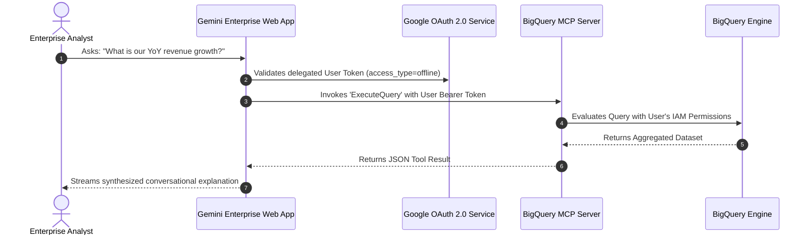

# Architecture Deep-Dive: Gemini Enterprise & BigQuery MCP Data Store

This document details the architectural mechanisms connecting **Gemini Enterprise** to **BigQuery** using the **Model Context Protocol (MCP)** standard.

---

## 1. What is a Custom MCP Server Data Store?

Gemini Enterprise supports connectors to SaaS tools and document repositories. A **Custom MCP Server Data Store** extends this capability by allowing Gemini to interact with any arbitrary system exposing an MCP-compliant interface.

In this architecture:
- **BigQuery MCP Server**: Google hosts an MCP server at `https://bigquery.googleapis.com/mcp`.
- **Transport**: Utilizes modern **StreamableHTTP** (replacing older Server-Sent Events / SSE transports).
- **Tools / Actions**: Exposes methods to list datasets, inspect schemas, and run SQL queries.

---

## 2. OAuth 2.0 User Delegation vs Service Accounts

Unlike background batch processors that run under a static Service Account, Gemini Enterprise business queries run under **User Delegation**:

### Security Advantages:
1. **Row & Column Level Security**: If a user does not have permission to view certain columns (e.g., PII or executive salaries), BigQuery enforces this at query runtime.
2. **Audit Logging**: Google Cloud CloudTrail/Cloud Audit Logs capture the exact end-user email executing each query rather than an opaque service account.
3. **Revocable Access**: When an employee departs, their corporate Google workspace deactivation automatically terminates their Gemini data store access.

---

## 3. Protocol Comparison: MCP StreamableHTTP vs Legacy SSE

| Dimension | Legacy SSE (Server-Sent Events) | StreamableHTTP (Modern MCP) |
| :--- | :--- | :--- |
| **Connection Model** | Long-lived half-duplex HTTP stream | Bidirectional, request-response over standard HTTP/2 |
| **Proxy & Firewall Compatibility** | Often blocked or timed out by corporate proxies | Fully compatible with standard enterprise API gateways |
| **Buffering & Streaming** | Unreliable buffering through intermediary load balancers | Native streaming chunks with backpressure |
| **Gemini Enterprise Support** | Deprecated / Unsupported | **Standard Supported Protocol** |
