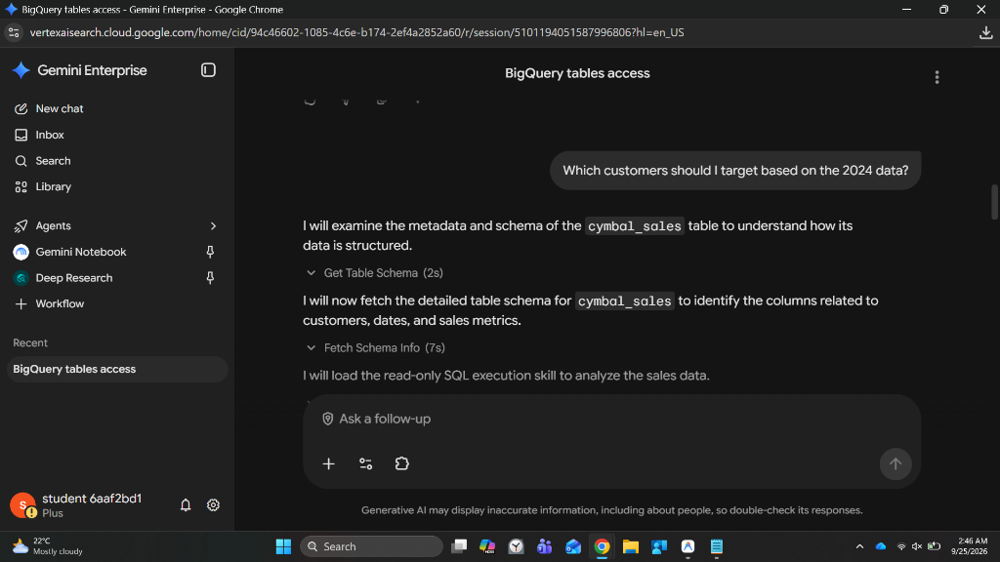
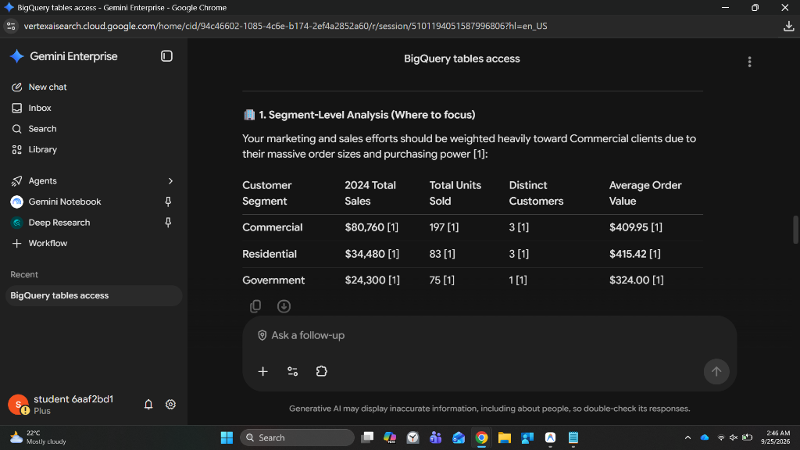

# Lab Execution Notes & Troubleshooting Guide

> **Lab**: Use a Custom MCP Server Data Store in Gemini Enterprise  
> **Directory**: `GCP/02-gemini-enterprise-bigquery-mcp-datastore/`  
> **Target Service**: BigQuery MCP Server (`https://bigquery.googleapis.com/mcp`)  
> **Status**: Active / In Progress

---

## 🚨 Troubleshooting & Resolved Incidents

### Incident 1: `Something went wrong while attempting to login: Failed to obtain refresh token.`

- **Occurred at**: Task 2 - Clicked **Verify Auth** in MCP Server Configuration.
- **Error Details**: `Failed to obtain refresh token.`
- **Root Causes & Solutions**:
  1. **Truncated Client Secret (Identified & Resolved)**:
     - Entered: `GOCSPX-DpSViLu1R5W7SFLGbEiyn0jXYr6` (34 chars)
     - Actual JSON: `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` (35 chars - missing trailing `S`)
     - **Fix**: Copied complete client secret from downloaded client JSON.
  2. **PKCE or HTTP Basic Auth Checkboxes Checked**:
     - Google OAuth 2.0 token endpoint expects credentials in the POST request body.
     - **Fix**: Uncheck both `Enable PKCE Support` and `Use HTTP Basic Authentication`.
  3. **Missing or Corrupted `access_type=offline` & `prompt=consent`**:
     - Google OAuth only issues a refresh token if `access_type=offline` and `prompt=consent` are present without leading/trailing spaces.
     - **Fix**: Ensured `Authorization URL Parameters` is exactly `&access_type=offline&prompt=consent`.
  4. **Student Account Selection**:
     - **Fix**: Ensured the popup authenticated with `student-01-...@qwiklabs.net`.

---

## 📋 Task-by-Task Checkpoint Matrix

| Task | Description | Critical Settings | Status | Notes |
| :--- | :--- | :--- | :---: | :--- |
| **Task 1** | Create OAuth Client | App Name: `bq_custom_mcp` Redirect URI: `https://vertexaisearch.cloud.google.com/oauth-redirect` | ✅ Completed | OAuth Client ID and Secret generated |
| **Task 2** | Create Custom MCP Data Store | URL: `https://bigquery.googleapis.com/mcp` Auth URL: `https://accounts.google.com/o/oauth2/auth` Params: `&access_type=offline&prompt=consent` Token: `https://oauth2.googleapis.com/token` Scope: `https://www.googleapis.com/auth/bigquery` PKCE: **OFF**, Basic Auth: **OFF** | ✅ Completed | Authentication verified & data store created |
| **Task 2.1** | Enable Custom Actions | Reload custom actions -> Select all -> Enable actions | ✅ Completed | BQ actions enabled |
| **Task 3** | Connect to Gemini Enterprise App | App Name: `gemini-bq-mcp-app` Region: `Global` Connect: `byo_bq_mcp` | ✅ Completed | Status verified as Active |
| **Task 4** | Run Natural Language Queries | Web App URL -> Authorize Connector -> Execute queries | ✅ Completed | Query executed against `cymbal_sales` |

---

## 📸 Verified Execution Evidence

### Screenshot 1: MCP Tool Calling & Schema Discovery
Demonstrates Gemini Enterprise autonomously executing MCP schema tools against the BigQuery `cymbal_sales` table:

### Screenshot 2: Natural Language SQL Execution & Segment Analysis
Demonstrates Gemini Enterprise returning synthesized segment analytics (Commercial, Residential, Government sales, units sold, and AOV) with citations:

