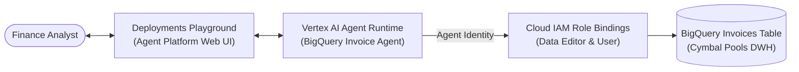
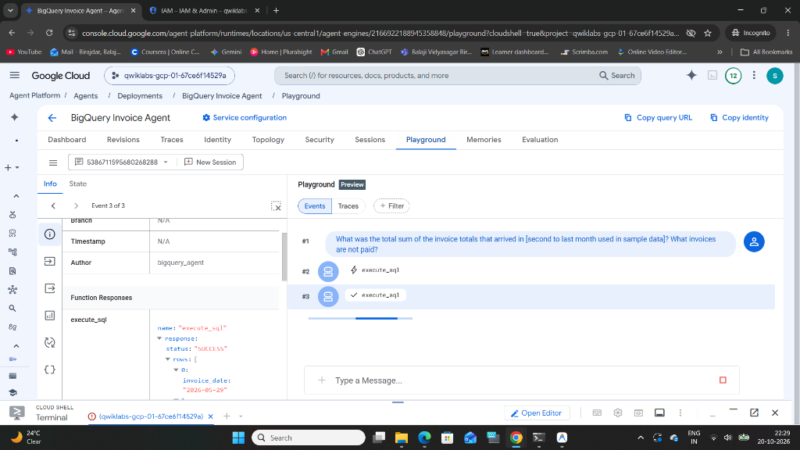
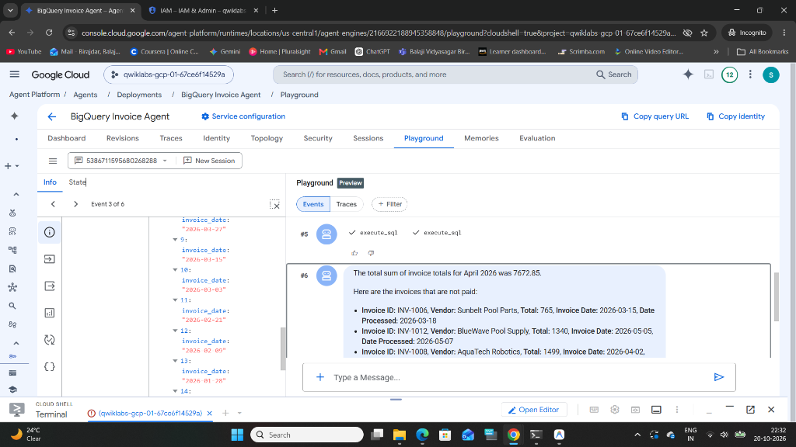

# 06. BigQuery-Enabled Agent on Agent Runtime with Agent Identity

[](https://cloud.google.com/vertex-ai)
[](https://cloud.google.com/bigquery)
[]()
[]()

> **Enterprise Financial Intelligence Reference Architecture**: Production implementation of an autonomous SQL-enabled AI agent deployed to **Vertex AI Agent Runtime (Reasoning Engine)** utilizing cryptographically isolated **Agent Identity** to securely query enterprise supplier invoices stored in **Google BigQuery**.

---

## 📌 Executive Summary & Business Scenario

### The Business Challenge: Cymbal Pools Supplier Operations
Cymbal Pools, a national provider of commercial and residential pool services, processes thousands of supplier invoices across regional distribution centers. Finance teams face delays tracking payment statuses, identifying unapproved invoices, and projecting 30-day cash flow requirements.

### The Solution
Instead of providing users with raw database access or building brittle custom dashboards:
1. A domain-specific **BigQuery Invoice Agent** is deployed to managed **Agent Runtime**.
2. **Dedicated Agent Identity (`types.IdentityType.AGENT_IDENTITY`)** provisions a unique principal identifier (`principal://agents.global.org-...`), enforcing absolute zero-trust isolation from developer credentials and compute engines.
3. Natural language questions are translated into optimized BigQuery SQL, executed under strict IAM controls (`roles/bigquery.dataEditor`, `roles/bigquery.user`).

---

## 🏛️ Architecture Overview



---

## 📸 Verification & Validation Artifacts

### 1. BigQuery Autonomous SQL Execution in Agent Runtime
The agent autonomously inspected the Cymbal Pools invoices dataset, generated standard SQL, and executed query jobs authenticated under its dedicated Agent Principal identity:



### 2. Conversational Financial Intelligence Output
The agent synthesized monthly invoice totals ($7,672.85 for April 2026) and identified all outstanding unpaid supplier invoices:



---

## 📂 Directory Layout

```
06-agent-runtime-bigquery-identity/
├── README.md                                  # Executive summary and architecture overview
├── lab_notes.md                               # Step-by-step reproduction playbook & query matrix
├── docs/
│   └── architecture.md                        # Deep dive on Agent Identity vs traditional Service Accounts
└── bigquery_agent_installer/
    ├── requirements.txt                       # Runtime and client dependencies
    ├── deploy.py                              # Deployment automation using Agent Identity
    └── bigquery_agent/
        ├── __init__.py
        ├── .env.example                       # Environment configuration template
        └── agent.py                           # ADK Agent definition with BigQuery toolset
```

---

## 🚀 Quickstart & Reproduction

Refer to the complete runbook in [`lab_notes.md`](./lab_notes.md) for full commands, IAM bindings, and validation queries.
