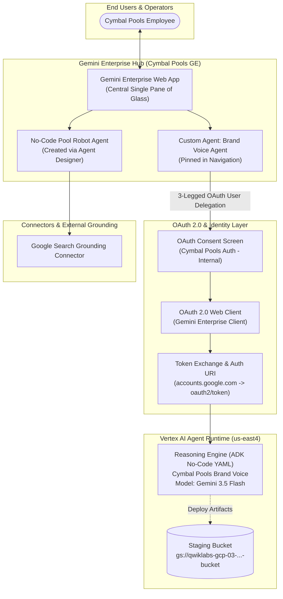

# Architecture & Integration Blueprint: Gemini Enterprise with ADK & Agent Designer

## 🏛️ System Architecture

---

## 🛡️ Integration & Delegation Standard

### 1. Dual Agent Modalities
- **No-Code Agent Designer**: Built directly within the Gemini Enterprise application for business analysts with instant Google Search grounding.
- **Enterprise ADK YAML Config**: Engineered declaratively via Google ADK (`root_agent.yaml`), deployed to managed Vertex AI Agent Runtime with dedicated compute scaling.

### 2. Zero-Trust User Delegation (OAuth 2.0 Web Client)
Access from Gemini Enterprise to the custom Agent Runtime engine is mediated through a 3-legged OAuth 2.0 authorization code flow:
- Authorized redirect URI: `https://vertexaisearch.cloud.google.com/static/oauth/oauth.html`
- Token endpoint: `https://oauth2.googleapis.com/token`
- Each user authenticates under their corporate identity, guaranteeing audit compliance and isolated execution sessions.
