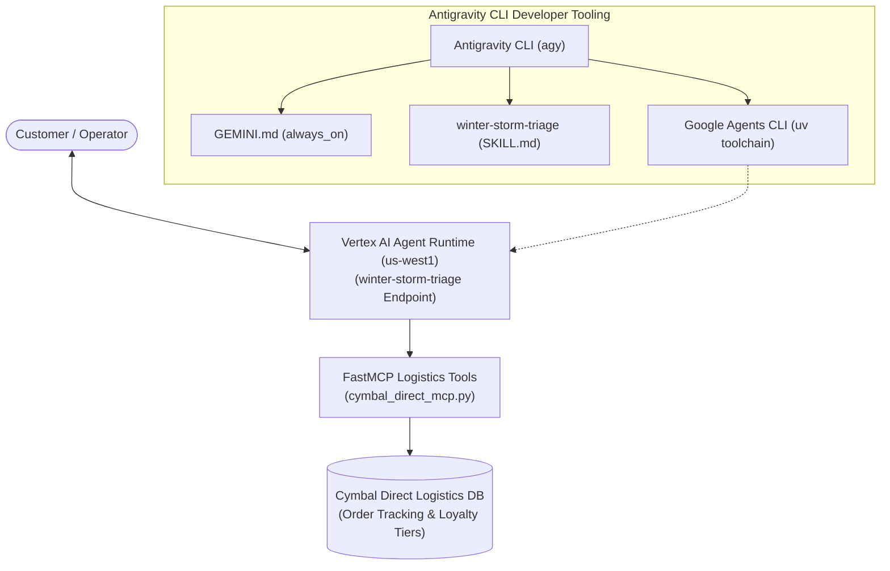

# 08. Accelerating Agentic AI Development with Antigravity & Agent Runtime

[-purple)](https://antigravity.google)
[-blue)](https://modelcontextprotocol.io)
[](https://google.github.io/agents-cli)
[](https://cloud.google.com/vertex-ai)

> **Enterprise Production Implementation**: End-to-end autonomous customer order triage agent built using the **Antigravity CLI (agy)**, integrating an external logistics database via **Model Context Protocol (MCP)**, enforcing declarative **Workspace Rules** & **Agent Skills**, and deployed to **Vertex AI Agent Runtime**.

---

## 📌 Executive Summary & Business Scenario

### The Business Challenge: Cymbal Direct Winter Storm Triage
Cymbal Direct, a national online retailer, experiences severe logistics disruptions caused by winter storm closures at major transit hubs. Inbound customer service volume surges by 400%, overwhelming human support staff with order delay inquiries and refund requests.

### The Solution Architecture
1. **Model Context Protocol (MCP)**: Logistics APIs (`get_order_status`, `get_customer_loyalty_info`, `issue_disruption_compensation`) are exposed to the Antigravity developer environment via a local FastMCP microservice.
2. **Declarative Workspace Rules (`GEMINI.md`)**: Configured with `always_on` triggers to mandate strict corporate copyright and docstring standards across all code.
3. **Custom Agent Skills (`SKILL.md`)**: Encapsulates tier-based loyalty compensation business rules into a modular skill invoked via `/winter-storm-triage`.
4. **Google Agents CLI Scaffolding**: Automatically generates a deployable agent project (`winter-storm-triage`).
5. **Serverless Deployment to Agent Runtime**: Deploys the agent to managed Google Cloud Agent Runtime in `us-west1` as a highly scalable operational endpoint.

---

## 🏛️ Architecture Overview



---

## 📂 Directory Layout

```
08-antigravity-mcp-agent-runtime/
├── README.md                                  # Executive summary & system architecture
├── lab_notes.md                               # Step-by-step reproduction playbook & grading summary templates
├── GEMINI.md                                  # Workspace rules enforcing coding standards
├── docs/
│   └── architecture.md                        # Architectural blueprint & protocol mechanics
├── mcp/
│   └── cymbal_direct_mcp.py                   # FastMCP logistics server implementation
├── .agents/
│   ├── mcp_config.json                        # Antigravity CLI MCP server registration
│   └── skills/
│       └── winter-storm-triage/
│           └── SKILL.md                       # Customer compensation standard operating procedure
└── winter-storm-triage/
    └── app/
        └── agent.py                           # Scaffolded ADK agent implementation
```

---

## 🚀 Quickstart & Reproduction

Refer to the complete runbook in [`lab_notes.md`](./lab_notes.md) for step-by-step commands, agy prompts, and summary upload specifications.
