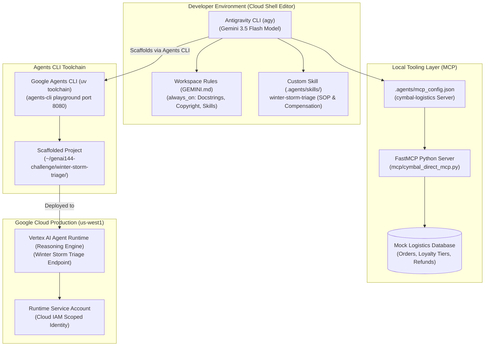

# Architecture & Integration Blueprint: Accelerate Development with Antigravity

## 🏛️ System Architecture

---

## 🛡️ Key Architectural Principles
1. **Model Context Protocol (MCP)**: Logistics data and refund actions are exposed as decoupled tools via FastMCP, allowing the agent to perform safe inspections and actions without hardcoded database access.
2. **Declarative Workspace Rules (`GEMINI.md`)**: Configured with `trigger: always_on` to ensure corporate copyright headers and docstring compliance across every file generated by the agent.
3. **Agent Skills Standard (`SKILL.md`)**: Formalizes customer compensation business logic into modular skill files that can be called by name (`/winter-storm-triage`).
4. **Serverless Agent Runtime**: The scaffolded project is packaged into an autonomous cloud endpoint deployed to Google Cloud Agent Runtime in `us-west1`.
