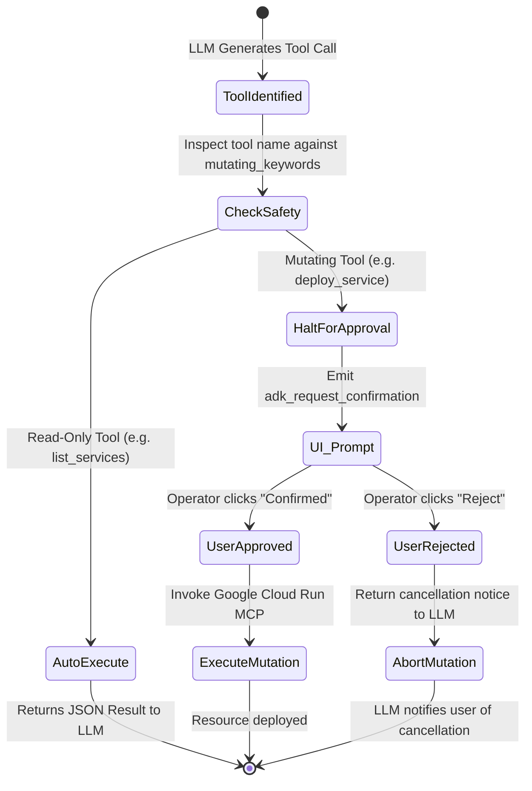

# Architecture Deep-Dive: Autonomous Cloud Run Agent & Human-in-the-Loop Safety

This whitepaper details the engineering principles behind combining **Google Agent Development Kit (ADK)**, Google's **Remote Cloud Run MCP Server**, and **Human-in-the-Loop (HITL) safety mechanisms**.

---

## 1. What is the Remote Cloud Run MCP Server?

Unlike custom MCP servers developed in-house, the **Google Remote Cloud Run MCP Server** (`https://run.googleapis.com/mcp`) is a Google-managed control-plane service:
- Exposed over **StreamableHTTP** transport.
- Directly translates standard MCP tool specifications into Google Cloud Run Admin API operations (`run.services.create`, `run.services.get`, `run.services.patch`, `run.services.delete`).
- Standardizes how any LLM agent interactively explores, inspects, and manages Cloud Run resources.

---

## 2. Authentication: The Header Provider Architecture

To authenticate against `https://run.googleapis.com/mcp`, the agent must provide an active Google Cloud OAuth token with the `https://www.googleapis.com/auth/cloud-platform` scope:

```python
async def cloud_run_header_provider(context: ReadonlyContext):
    """Dynamic header provider invoked on every MCP tool call to guarantee token freshness."""
    credentials, project = google.auth.default(
        scopes=['https://www.googleapis.com/auth/cloud-platform']
    )
    credentials.refresh(Request())
    return {"Authorization": f"Bearer {credentials.token}"}
```

By supplying a `header_provider` callback to `StreamableHTTPConnectionParams`, ADK automatically refreshes expiring tokens in the background without dropping active agent sessions.

---

## 3. Human-in-the-Loop (HITL) Safety Design Pattern

In production DevOps, an agent must **never** be given unilateral permission to destroy or mutate cloud resources.

### The Interception Mechanism
ADK exposes a tool property called `_require_confirmation`:
- When set to `False`, ADK executes the tool call immediately and passes the output to the LLM.
- When set to `True`, the ADK runtime **halts execution** and yields a special `adk_request_confirmation` event to the client interface (ADK Web UI, Slack, or Teams).
- The execution thread is frozen until an authenticated human operator submits an explicit approval or rejection.



---

## 4. Key Governance Roles: `roles/mcp.toolUser`

Google Cloud introduces the dedicated IAM role:
- **`roles/mcp.toolUser`**: Explicitly authorizes a caller or service account to discover and invoke tools on Google-managed remote MCP servers.
- Combined with **`roles/run.developer`**, the service account is strictly limited to deploying and updating Cloud Run workloads without granting full project owner or admin privileges.
