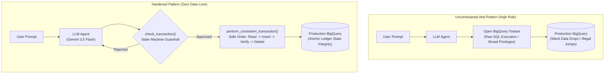
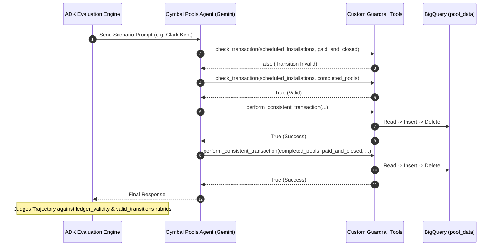

# System Architecture: Agent Evaluation & Deterministic Guardrails

## 1. Architectural Philosophy: The Tool-Boundary Constraint

In traditional generative AI prototypes, developers often grant agents broad database access using open-ended toolsets (such as `bigquery_toolset` or raw SQL execution tools). While flexible, this approach introduces catastrophic reliability risks in production enterprise applications.

---

## 2. Threat & Defect Analysis

### Defect 1: Ledger Inconsistency & Data Loss
* **Mechanism**: During multi-step database operations, an unconstrained agent may invoke `delete_from_table` before confirming that `write_to_table` succeeded, or delete a record in response to a customer cancellation when company policy requires archival.
* **Impact**: Permanent loss of customer contact info, project history, and billing records.
* **Engineering Solution**: The `perform_consistent_transaction()` wrapper coordinates the read, insert, and delete operations into a strictly ordered pipeline. Deletion is physically impossible until the insert operation confirms a `"Success"` status code.

### Defect 2: Workflow Stage Skipping
* **Mechanism**: A customer says, *"I'm ready to pay off my pool and close my account."* The unconstrained model, prioritizing helpfulness over process governance, attempts to move the record directly from `scheduled_installations` to `paid_and_closed`.
* **Impact**: Bypasses required quality inspections, subcontractor milestone payouts, and municipal safety permits.
* **Engineering Solution**: The `check_transaction()` tool evaluates stage transitions as edges in a directed acyclic graph (DAG). Any edge not explicitly declared in `valid_transitions` returns `False`, forcing the agent to inform the user that construction must be completed first.

---

## 3. Evaluation Mechanics: Multi-Turn Trajectory Rubrics

Most AI evaluations evaluate only the **final text response** (e.g., semantic similarity to a reference string). For database-connected agents, this is insufficient: an agent could output a polite, correct-sounding response while silently executing destructive SQL queries in the background.

The Google ADK CLI evaluates the **entire tool trajectory**:
1. What tools were requested?
2. What arguments were passed?
3. Were invalid transitions attempted?
4. Did record counts and table states remain consistent throughout?

---

## 4. Production Hardening Roadmap

For enterprise-scale production rollouts, the following hardening steps are established:

| Layer | Prototype Implementation | Enterprise Production Standard |
| :--- | :--- | :--- |
| **Transaction Atomicity** | Sequential Python helper calls | Multi-statement BigQuery SQL `BEGIN TRANSACTION ... COMMIT TRANSACTION` |
| **Tool Execution Enforcement** | Model prompt directs tool order | Embed `check_transaction()` directly inside `perform_consistent_transaction()` as a mandatory precondition |
| **SQL Injection Prevention** | Parameterized scalar parameters | Allowlist table validation before query construction |
| **Idempotency** | Non-idempotent inserts | Idempotency keys (`UUIDv4`) stored per transaction to prevent double-charging or double-inserting |
| **Audit Trails** | Structured JSON logging | BigQuery audit log sink capturing all agent decisions and operator IDs |
