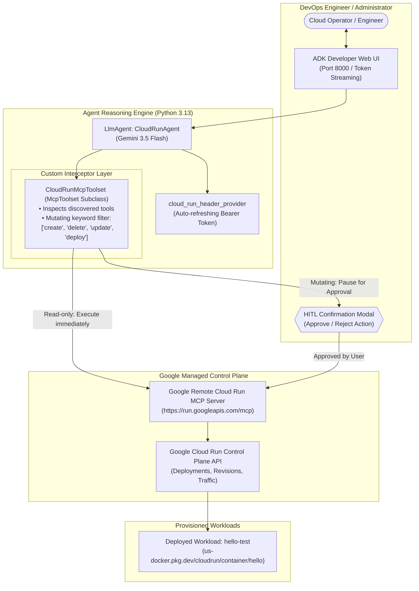
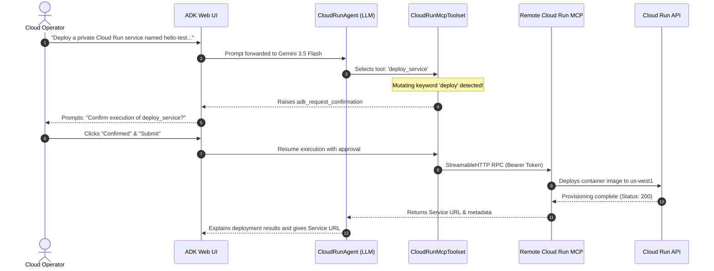

# Autonomous Cloud Operations: AI Agent with Google Cloud Run Remote MCP Server & Human-in-the-Loop Guardrails

[](https://google.github.io/adk-docs/)
[](https://cloud.google.com/run)
[](https://modelcontextprotocol.io/)
[-green)]()

> **Enterprise Architecture Showcase**: An autonomous DevOps & Cloud Operations AI Agent built with the **Google Agent Development Kit (ADK)** that interacts directly with Google's managed **Remote Cloud Run MCP Server** (`https://run.googleapis.com/mcp`). Features **Human-in-the-Loop (HITL) tool interception** to enforce explicit administrator confirmation before executing mutating or destructive cloud actions.

---

## 📌 Executive Summary & Business Value

Managing enterprise cloud infrastructure traditionally requires navigating complex consoles, writing Terraform scripts, or running CLI commands. While LLMs can generate infrastructure code, letting an AI agent autonomously execute cloud mutations without guardrails introduces severe operational risks.

This solution demonstrates an **Enterprise-Grade Cloud Operations Agent**:

1. **Google-Managed Remote MCP Server**: Direct integration with Google Cloud's official Cloud Run MCP endpoint (`https://run.googleapis.com/mcp`), enabling agents to discover and execute Cloud Run control-plane operations dynamically.
2. **Human-in-the-Loop (HITL) Guardrails**: A custom toolset interceptor (`CloudRunMcpToolset`) dynamically flags all mutating operations (`create`, `update`, `delete`, `deploy`) with `_require_confirmation = True`, requiring the human administrator to review and click **Confirm** in the ADK UI before changes are committed.
3. **Conversational DevOps**: Natural language cloud management: listing revisions, inspecting container health, deploying serverless microservices, and toggling authentication policies on demand.
4. **Least-Privilege IAM Governance**: Authenticated via dedicated Service Account holding the fine-grained `roles/mcp.toolUser` and `roles/run.developer` roles.

---

## 🏛️ System Architecture



---

## 🛡️ Human-in-the-Loop (HITL) Tool Interception

To prevent accidental outages, the agent dynamically parses tools exposed by the remote MCP server and classifies them into **Safe (Read-Only)** vs **Mutating (High-Risk)**:

```python
class CloudRunMcpToolset(McpToolset):
    """Dynamically enforces confirmation on mutating tools discovered from MCP server."""
    async def get_tools(self, readonly_context: Optional[ReadonlyContext] = None) -> List[BaseTool]:
        tools = await super().get_tools(readonly_context)
        for t in tools:
            mutating_keywords = [
                "delete", "update", "replace", "create", "set", "remove", "run", "deploy"
            ]
            if any(k in t.name.lower() for k in mutating_keywords):
                t._require_confirmation = True  # Pauses execution for user UI confirmation
            else:
                t._require_confirmation = False # Read-only queries execute seamlessly
        return tools
```

---

## 🔄 Autonomous Lifecycle Workflow



---

## 📂 Repository Structure

```text
GCP/multi-agent-systems/cloudrun-remote-mcp-hitl/
├── README.md                           # Master executive and technical showcase
├── crun_agent/
│   ├── __init__.py                     # Package export
│   ├── agent.py                        # ADK LlmAgent with CloudRunMcpToolset HITL logic
│   ├── requirements.txt                # Pinned ADK & MCP dependencies
│   └── .env.example                    # Environment template with Vertex AI configuration
└── docs/
    └── architecture.md                 # Deep-dive: Remote MCP Servers & HITL Safety Patterns
```

---

## 🏢 Business Applications for Enterprise Clients (WeWork)

1. **Self-Service Developer Sandboxes**: Developers can request ephemeral Cloud Run environments in Slack/Teams without requiring GCP Console access; the agent deploys sandbox services and applies strict budget labels.
2. **Autonomous Incident Triage**: On production alerts, the agent inspects revisions, fetches failing container logs via MCP, and suggests rollback revisions subject to human approval.
3. **Automated Traffic Shifting & Canary Deployments**: Safely executing blue-green canary rollouts by instructing the agent to split traffic (e.g., 90/10) with mandatory HITL sign-off.
