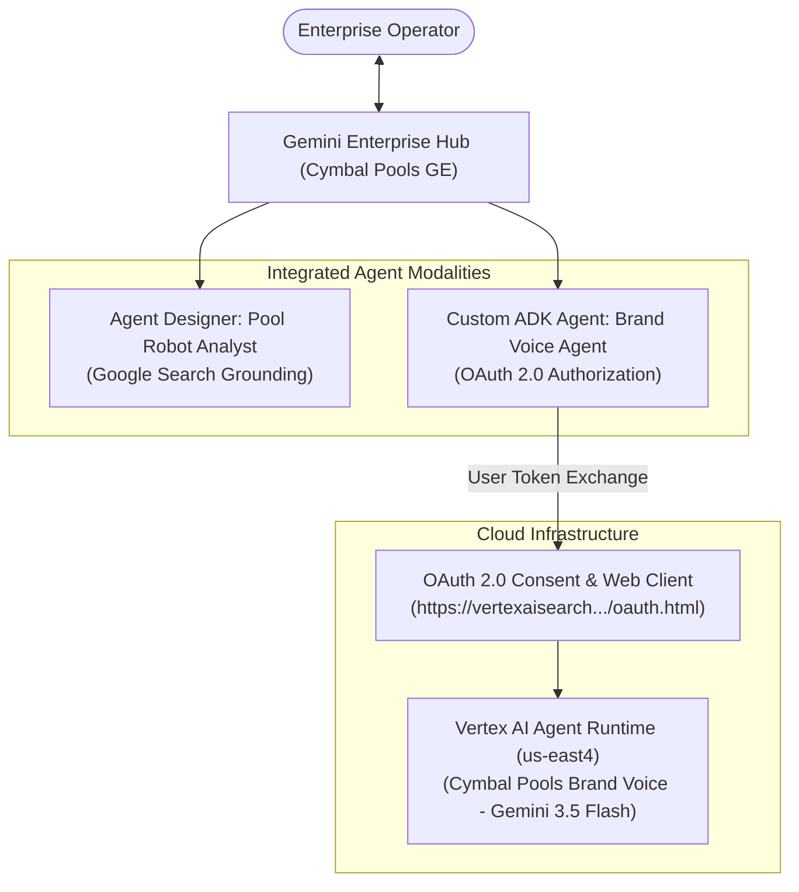
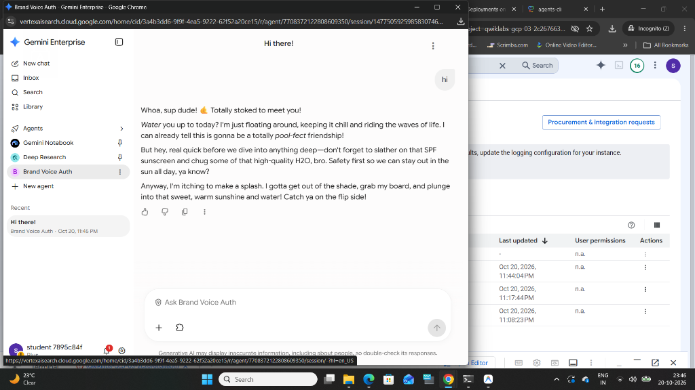

# 07. Multi-Agent Ecosystem in Gemini Enterprise: Agent Designer & ADK Agent Runtime

[](https://cloud.google.com/gemini)
[](https://google.github.io/adk-docs/)
[](https://cloud.google.com/vertex-ai)
[]()

> **Enterprise GenAI Reference Architecture**: Unified enterprise agent hub on **Gemini Enterprise** integrating **No-Code Agent Designer** agents with declarative **ADK Agent Runtime** microservices secured via **3-legged OAuth 2.0 user delegation**.

---

## 📌 Executive Summary & Business Scenario

### The Business Challenge: Cymbal Pools Omnichannel Brand Voice
Cymbal Pools manages hundreds of service technicians, pool maintenance staff, and customer support representatives across the United States. To build brand loyalty, corporate communications requires:
1. Transforming dry, technical service tickets (e.g., equipment delivery, maintenance alerts) into Cymbal Pools' signature **laid-back, surfer-dude brand voice**.
2. Providing operations managers with an instant intelligence tool to research new market innovations in commercial pool robotics grounded in live web data.
3. Centralizing all agent workflows inside a unified enterprise portal (**Gemini Enterprise**) governed by corporate identity and OAuth 2.0 user delegation.

---

## 🏛️ Architecture Overview



---

## 📸 Verification & Validation Artifacts

### 1. Conversational Chat in Gemini Enterprise (Surfer-Dude Brand Voice)
The agent autonomously converted maintenance alerts and customer messaging into the Cymbal Pools laid-back surfer-dude persona with pool puns and hydration reminders:



---

## 📂 Directory Layout

```
GCP/multi-agent-systems/enterprise-brand-voice-designer/
├── README.md                                  # Executive summary & system architecture
├── docs/
│   └── architecture.md                        # Deep dive into OAuth delegation & Agent Designer vs ADK
└── adk_brand_agent/
    ├── requirements.txt                       # Runtime dependencies
    ├── construct_auth_uri.py                  # OAuth 2.0 authorization URL builder
    └── brand_voice/
        ├── .env.example                       # Environment configuration template
        └── root_agent.yaml                    # Declarative ADK Agent Config YAML
```

---

## 🚀 Architecture & Verification

Refer to [`docs/architecture.md`](./docs/architecture.md) for full commands, OAuth flow breakdown, and validation prompts.
