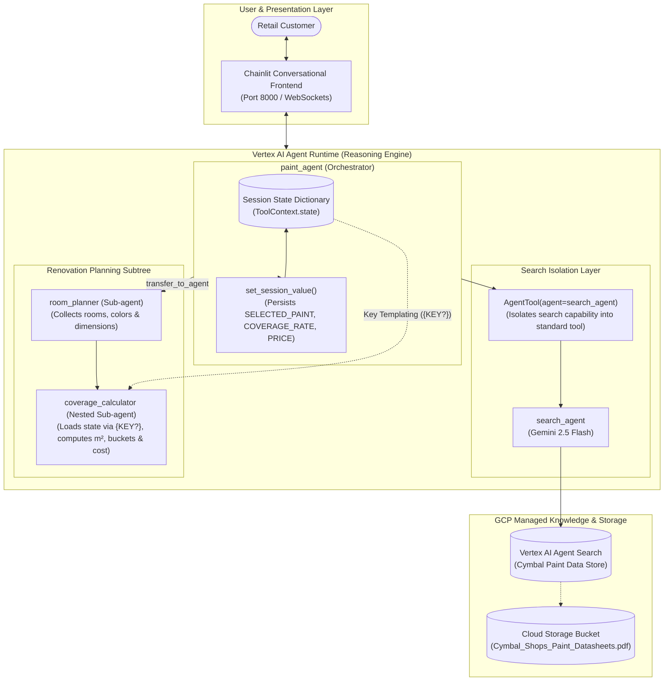
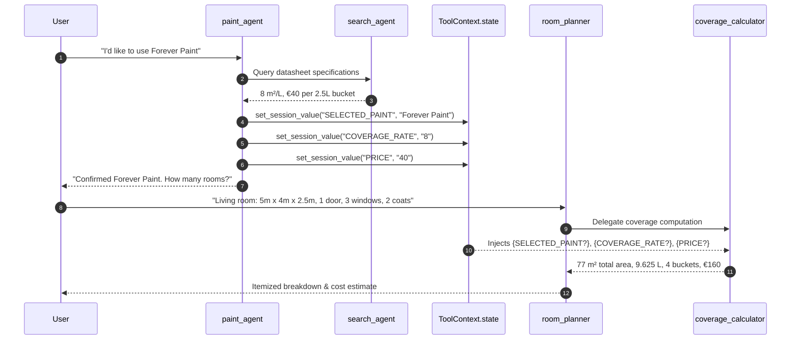

# System Architecture: Multi-Agent Systems on Agent Runtime with Vertex AI Search

## 1. High-Level Orchestration Topology

Enterprise conversational systems frequently require a hybrid mix of **unstructured document search** (product datasheets, catalog manuals) and **deterministic calculations** (surface area, architectural deductions, cost estimates). 

To ensure modularity and avoid prompt bloat, the architecture separates concerns across specialized sub-agents coordinated by a central root agent:



---

## 2. The `AgentTool` Pattern: Bypassing Tool-Conflict Constraints

### The Problem
Vertex AI and Gemini enforce strict tool validation rules:
> `400 INVALID_ARGUMENT: Multiple tools are supported only when they are all search tools.`

When building multi-agent systems, if an agent registers a search tool (`VertexAiSearchTool`) alongside regular Python function tools, the API call rejects the request. Even having a sub-agent with a search tool can trigger this, as sub-agents introduce an implicit `transfer_to_agent` function tool.

### The Solution: Agent-as-a-Tool Wrapping
Google ADK provides the `AgentTool` class, which encapsulates an entire agent (including its search tool) into a standard, callable function tool from the perspective of the parent agent:

```python
search_tool = AgentTool(
    agent=search_agent,        # Isolated search agent with VertexAiSearchTool
    skip_summarization=False,  # Returns synthesized search findings to root agent
)
```

This pattern isolates the search execution context, allowing the root agent to freely pair search capabilities with arbitrary Python tools (`set_session_value`).

---

## 3. Session State Persistence & Key Templating

Multi-turn dialogues require sharing context across distinct agents without forcing the end user to repeat themselves.



### ADK Key Templating Syntax: `{KEY?}`
In agent prompt instructions, wrapping state keys in curly braces with a trailing question mark (`{SELECTED_PAINT?}`) achieves two critical behaviors:
1. **Dynamic Runtime Interpolation**: Injects the value from `ToolContext.state` if it exists.
2. **Graceful Fallback**: If the key has not been set yet, the template renders cleanly without crashing the agent.

---

## 4. Managed Agent Runtime Architecture

Deploying via `adk deploy agent_engine` packages the agent code into a **Vertex AI Reasoning Engine** microservice:
- **Serverless & Autoscaling**: Zero-idle compute with automatic scale-to-demand.
- **Enterprise IAM Authentication**: Governed by `roles/aiplatform.user` and `roles/discoveryengine.user`.
- **SDK Connectivity**: Clean Python SDK interaction via `ReasoningEngineClient()`.
