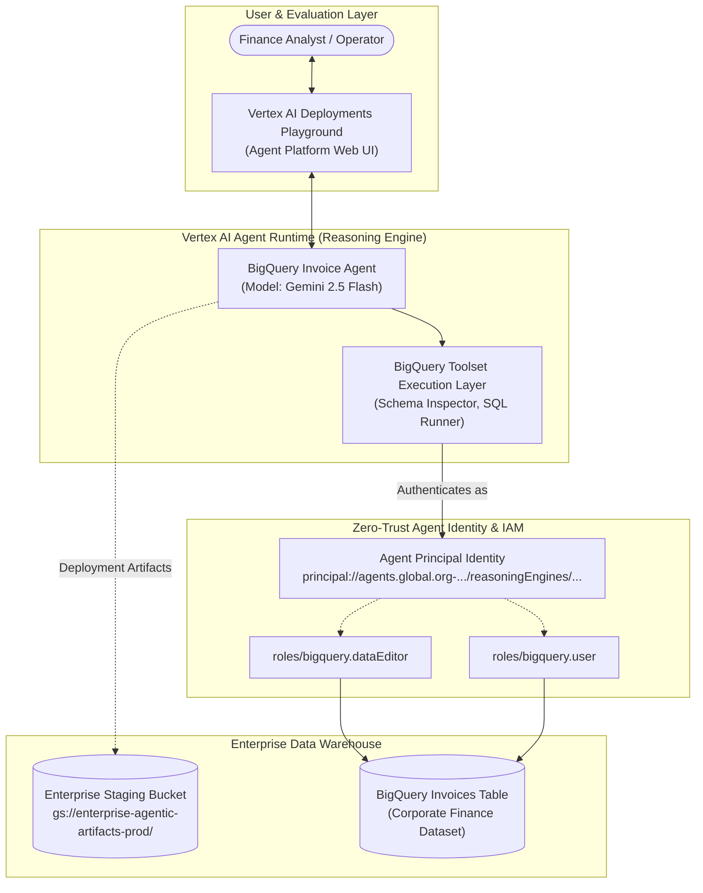

# Architecture & Security Blueprint: BigQuery Agent with Agent Identity

## 🏛️ System Architecture

---

## 🛡️ Core Security Architecture: Agent Identity

In traditional cloud agent deployments, workloads often rely on default compute service accounts (e.g., Compute Engine default SA) or end-user identity propagation. This introduces significant risks:
1. **Privilege Over-Assignment**: Default service accounts often hold broad `Editor` or `Viewer` permissions across the entire project.
2. **Blast Radius Expansion**: If multiple agents or workloads share one service account, compromising one agent compromises access to unrelated datasets.

### The Agent Identity Pattern
By setting `identity_type = types.IdentityType.AGENT_IDENTITY`, Google Cloud provisions a cryptographically isolated **Agent Principal** tied strictly to the specific Reasoning Engine instance:

$$\text{Principal} = \text{principal://agents.global.org-\textit{ORG\_ID}.system.id.goog/resources/aiplatform/projects/\textit{PROJECT\_NUMBER}/locations/\textit{REGION}/reasoningEngines/\textit{ENGINE\_ID}}$$

### Least-Privilege IAM Enforcement
Only the exact roles required to inspect and query the targeted dataset are granted to this unique identity:
- **`roles/bigquery.dataEditor`**: Grants table read/write capabilities needed to evaluate queries and temporary tables.
- **`roles/bigquery.user`**: Grants permission to run BigQuery query jobs and allocate compute slots.
