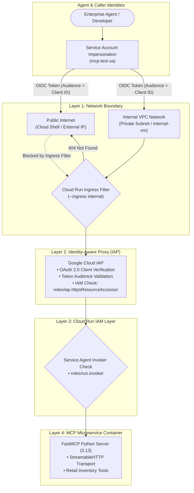

# Enterprise Zero-Trust MCP: Securing Cloud Run MCP Servers with Google Identity-Aware Proxy (IAP) & VPC Ingress Hardening

[](https://cloud.google.com/run)
[-red?logo=google)](https://cloud.google.com/iap)
[](https://modelcontextprotocol.io/)
[]()

> **Enterprise Architecture Showcase**: A production-grade **Defense-in-Depth Zero-Trust blueprint** for securing **Model Context Protocol (MCP)** tool servers on **Google Cloud Run**. Combines **Google Identity-Aware Proxy (IAP)**, **OAuth 2.0 Client Identity verification**, **IAM Service Account impersonation with audience claims**, and **Private VPC Ingress restriction**.

---

## 📌 Executive Summary & Enterprise Value

As enterprises deploy autonomous AI agents, MCP tool servers become the gateway to proprietary business logic, databases, and operational APIs. **Leaving MCP endpoints publicly accessible or protected only by static API keys introduces severe security vulnerabilities.**

This implementation establishes an **Enterprise Zero-Trust Boundary** around MCP tool servers:

1. **Defense-in-Depth Layering**: No single point of failure. Requests must traverse **Private VPC Ingress**, **IAP Gateway Verification**, **IAM Role Validation (`roles/iap.httpsResourceAccessor`)**, and **Cloud Run Service Agent Authorization (`roles/run.invoker`)**.
2. **Elimination of Static Keys**: Replaced vulnerable long-lived API tokens with **ephemeral OpenID Connect (OIDC) identity tokens** scoped strictly to the target OAuth Client ID audience.
3. **Network Isolation**: By setting Cloud Run ingress to `internal`, all direct public internet access is completely blocked (`HTTP 404`). Traffic is only reachable from internal VPC networks or authenticated IAP tunnels.
4. **Agent-Ready Governance**: Any AI agent or developer accessing retail product tools (`get_products_by_category`, `get_product_details`, `get_low_inventory_products`) is fully audited with verifiable caller identities in Google Cloud Audit Logs.

---

## 🏛️ Zero-Trust Security Architecture



---

## 🔒 Layer-by-Layer Security Enforcement

| Defense Layer | Technology | Mechanism | Threat Mitigated |
| :--- | :--- | :--- | :--- |
| **Layer 1: Network Ingress** | Cloud Run VPC Ingress | `--ingress internal` blocks requests outside the GCP project VPC. | Denial-of-Service, port scanners, and unrouted public traffic. |
| **Layer 2: Identity Boundary** | Identity-Aware Proxy (IAP) | Custom OAuth 2.0 Client ID + Secret validation. Verifies signed OIDC tokens. | Forged credentials, token replay attacks across different services. |
| **Layer 3: IAM Access Control** | Cloud IAM Policies | `roles/iap.httpsResourceAccessor` granted strictly to authorized service accounts. | Unauthorized lateral movement from unauthorized GCP principals. |
| **Layer 4: Service Invoker** | Cloud Run Service Agent | `roles/run.invoker` granted exclusively to `service-${PROJECT_NUMBER}@gcp-sa-iap`. | Direct invocation bypassing the IAP security proxy. |

---

## 🧩 Protocol Specification: FastMCP StreamableHTTP

The microservice runs **FastMCP** over **StreamableHTTP**, handling standard JSON-RPC 2.0 tool discovery and execution:

### 1. Tool Discovery (`tools/list`)
```bash
curl -X POST "${MCP_SERVER_URL}/mcp" \
  -H "Authorization: Bearer $TOKEN" \
  -H "Content-Type: application/json" \
  -H "Accept: application/json, text/event-stream" \
  -d '{"jsonrpc": "2.0", "id": 1, "method": "tools/list"}'
```

### 2. Tool Execution (`tools/call`)
```bash
curl -sS -X POST "${MCP_SERVER_URL}/mcp" \
  -H "Authorization: Bearer $TOKEN" \
  -H "Content-Type: application/json" \
  -H "Accept: application/json, text/event-stream" \
  -d '{
    "jsonrpc": "2.0",
    "id": 2,
    "method": "tools/call",
    "params": {
      "name": "get_product_details",
      "arguments": { "name": "Heather Gray Hoodie" }
    }
  }' | sed -n 's/^data: //p' | jq .
```

---

## 📂 Repository Structure

```text
GCP/security-and-governance/cloudrun-iap-zero-trust-mcp/
├── README.md                           # Master executive and technical showcase
├── mcp-on-cloudrun/                    # FastMCP Server Application Source
│   ├── server.py                       # FastMCP server with retail tools
│   ├── Dockerfile                      # Cloud Run container definition
│   └── pyproject.toml                  # Python 3.13 dependencies (fastmcp 2.12.4)
├── docs/
│   └── architecture.md                 # Deep-dive whitepaper: IAP Zero-Trust & Ingress Hardening
└── scripts/
    └── test_mcp_iap.sh                 # Verification script for token minting and tool execution
```

---

## 🏢 Enterprise Relevance for Clients (WeWork)

This pattern is a prerequisite for enterprise agent architectures:
- **Private Workplace Operations**: Protecting desk management, conference room scheduling, and badge-access MCP tools from unauthorized public access.
- **Financial & Tenant APIs**: Ensuring AI billing inquiry tools can only be invoked by authenticated agents holding specific IAM resource accessor grants.
- **Compliance & Auditability**: SOC2, ISO27001, and HIPAA compliance require auditable caller identity trails rather than anonymous tool invocations.
