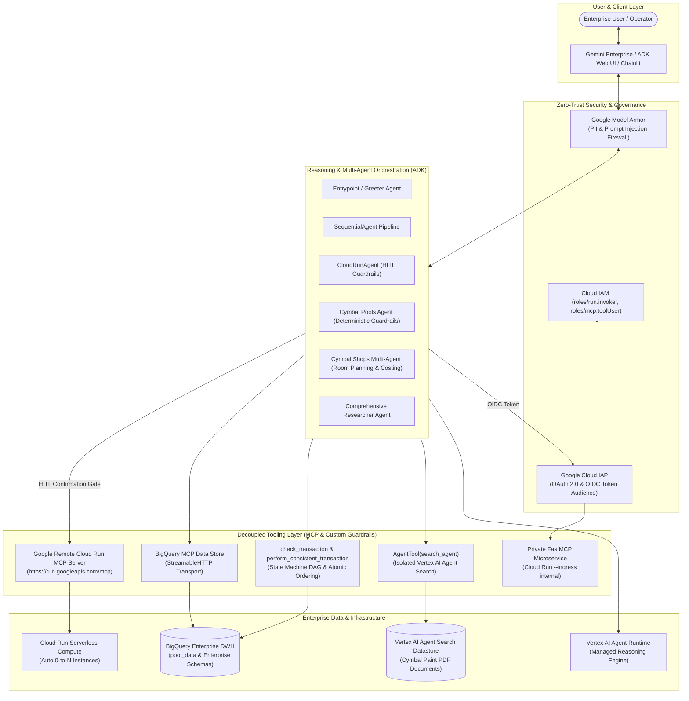

# Enterprise Agentic AI & Zero-Trust Cloud Architecture Portfolio

[-purple)](https://modelcontextprotocol.io/)

> **Enterprise Solution Accelerator & Engineering Showcase**: A production-ready portfolio of **Autonomous AI Agent Systems**, **Model Context Protocol (MCP) integrations**, **Zero-Trust Security architectures**, and **Conversational Data Warehouse Grounding** built on **Google Cloud Platform (GCP)** and **Vertex AI**.

---

## 📌 Executive Summary

Modern enterprise adoption of Generative AI requires transitioning from simple chat interfaces to **autonomous, secure, and tool-augmented multi-agent systems**. 

This repository demonstrates production-grade reference implementations solving the critical enterprise challenges of:
1. **Decoupled Architecture**: Separating reasoning layers from operational tooling layers via the open **Model Context Protocol (MCP)** standard.
2. **Zero-Trust Tool Governance**: Securing MCP servers on Google Cloud Run using **Identity-Aware Proxy (IAP)**, OIDC token audience claims, and private VPC ingress hardening.
3. **Conversational Data Grounding**: Enabling natural language SQL analytics over enterprise **BigQuery** data warehouses with user-delegated OAuth 2.0 permissions.
4. **DevOps Automation with Guardrails**: Autonomous infrastructure management via **Google Remote Cloud Run MCP** coupled with **Human-in-the-Loop (HITL)** approval gates for destructive mutations.
5. **Bilateral AI Security**: Intercepting prompt injections, sensitive data exposure, and toxic outputs using **Google Model Armor**.
6. **Agent Reliability & Trajectory Evaluations**: Eliminating silent database record drops and illegal workflow shortcuts through automated **Google ADK multi-turn rubric evaluations** and deterministic state machine Python tools.
7. **Collaborative Multi-Agent Architectures**: Combining unstructured document search (Vertex AI Agent Search) with dynamic mathematical reasoning and session state persistence on **Vertex AI Agent Runtime**.

---

## 🏛️ High-Level Enterprise Architecture

---

## 📂 Enterprise Solution Architectures

### 🛡️ 1. Security & Governance
| Reference Architecture | Core Technologies | Architecture Pattern & Focus | Status |
| :--- | :--- | :--- | :---: |
| [**Model Armor LLM Firewall**](./GCP/security-and-governance/model-armor-llm-firewall/) | **Gemini Enterprise, Model Armor, Workspace RAG, Gemini 3.1 Pro** | Bilateral AI Security Firewall (Prompt Injection / PII Blocker), Multi-Source ACLs | ✅ Complete |
| [**Cloud Run IAP Zero-Trust MCP**](./GCP/security-and-governance/cloudrun-iap-zero-trust-mcp/) | **Cloud Run, Identity-Aware Proxy (IAP), FastMCP, VPC Ingress** | 4-Layer Defense-in-Depth for MCP Tools, Audience Validation, Network Hardening | ✅ Complete |
| [**Agent Identity Workload Federation**](./GCP/security-and-governance/agent-identity-workload-federation/) | **Vertex AI Agent Runtime, BigQuery, Agent Identity, Gemini 2.5 Flash** | Autonomous SQL Financial Analytics, Zero-Trust Agent Principal Isolation | ✅ Complete |

### 🤖 2. Multi-Agent Systems & Tooling
| Reference Architecture | Core Technologies | Architecture Pattern & Focus | Status |
| :--- | :--- | :--- | :---: |
| [**ADK MCP Cloud Run Orchestration**](./GCP/multi-agent-systems/adk-mcp-cloudrun-orchestration/) | **Google ADK, FastMCP, Cloud Run, Vertex AI** | Decoupled Reasoning vs Tooling, Sequential Multi-Agent Orchestration, Serverless Autoscaling | ✅ Complete |
| [**Cloud Run Remote MCP with HITL**](./GCP/multi-agent-systems/cloudrun-remote-mcp-hitl/) | **Google ADK, Google Remote MCP, Gemini, HITL Guardrails** | Autonomous Cloud Operations, Dynamic Tool Interception, Mutating Action Approvals | 🔄 In Progress |
| [**Retail Paint Planner Sub-Agents**](./GCP/multi-agent-systems/retail-paint-planner-subagents/) | **Google ADK, Vertex AI Search, Agent Runtime, Chainlit** | Multi-Agent Collaborative Architecture, AgentTool Search Isolation, Session State Persistence | ✅ Complete |
| [**Enterprise Brand Voice Designer**](./GCP/multi-agent-systems/enterprise-brand-voice-designer/) | **Gemini Enterprise, Agent Designer, ADK Agent Runtime, OAuth 2.0 Delegation** | Multi-Agent Enterprise Portal, Grounded Search & Declarative Brand Voice Microservices | ✅ Complete |

### 📊 3. Data Runtime, Analytics & Evaluations
| Reference Architecture | Core Technologies | Architecture Pattern & Focus | Status |
| :--- | :--- | :--- | :---: |
| [**BigQuery Agent Trajectory Evals & Guardrails**](./GCP/data-runtime-and-evals/bigquery-agent-eval-guardrails/) | **Google ADK, BigQuery, Gemini 3.5 Flash, Trajectory Evals** | Automated Agent Evaluation, Deterministic State Machine Guardrails, Zero Data Loss | ✅ Complete |
| [**BigQuery MCP Enterprise Analytics**](./GCP/data-runtime-and-evals/bigquery-mcp-enterprise-analytics/) | **Gemini Enterprise, BigQuery, MCP StreamableHTTP, OAuth 2.0** | Zero-ETL Data Warehouse Grounding, Dynamic Tool Discovery, User-Delegated Security | ✅ Complete |
| [**Antigravity MCP Logistics Runtime**](./GCP/data-runtime-and-evals/antigravity-mcp-logistics-runtime/) | **Antigravity CLI (agy), MCP, FastMCP, Google Agents CLI, Agent Runtime** | Declarative Workspace Rules, Custom Skills, Logistics Triage Microservice | ✅ Complete |

---

## 🛡️ Core Enterprise Architectural Standards

### 1. Separation of Concerns (Reasoning vs. Tooling)
* LLM reasoning engines should never be tightly coupled to proprietary databases or internal APIs.
* By implementing the **Model Context Protocol (MCP)**, tool microservices maintain independent release cycles, monitoring, and scaling.

### 2. Zero-Trust Identity-Aware Defense-in-Depth
* MCP tool endpoints are never left exposed to the public internet.
* All tool calls require authenticated **OpenID Connect (OIDC) identity tokens** scoped to the target resource's OAuth Client ID (`aud` claim).
* Network ingress is locked down to `--ingress internal`, blocking unrouted public internet traffic at the perimeter.

### 3. Human-in-the-Loop (HITL) Execution Safety
* Autonomous agents operating against cloud infrastructure or enterprise records must not have unchecked write/delete permissions.
* Mutating keywords (`create`, `deploy`, `update`, `delete`) trigger mandatory `_require_confirmation = True` gates in the UI before actions execute.

### 4. Deterministic Guardrails & Automated Trajectory Evaluation
* LLM prompts alone are probabilistic and insufficient to guarantee data safety across transactional tables.
* Critical business state transitions must be verified in software via deterministic state-machine validators (`check_transaction`) and atomic transaction wrappers (`perform_consistent_transaction`).
* Automated multi-turn trajectory rubrics (`adk eval`) measure tool-call accuracy and prevent regressions before production deployment.

### 5. Multi-Agent Tool Isolation (`AgentTool` Pattern)
* Solves cloud provider tool conflict limits (such as Vertex AI's restriction preventing native search tools from being combined with custom function tools).
* Encapsulates document-search agents inside `AgentTool` instances to permit arbitrary session state and calculation tools to run in tandem.

### 6. Zero-ETL In-Place Data Grounding
* Avoids costly vector ingestion pipelines for tabular enterprise data.
* Natural language questions are converted into governed SQL queries evaluated directly inside BigQuery under the end user's IAM permissions.

---

## 🚀 Repository Navigation

Each solution directory contains:
- **`README.md`**: Executive summary, system architecture diagrams, business use cases, and configuration parameters.
- **Application Code**: Production Python implementations (`agent.py`, `server.py`, `Dockerfile`, `requirements.txt`).
- **`docs/`**: Technical whitepapers detailing protocol mechanics, IAM flows, and sample enterprise query cookbooks.

---

## 🏢 Business Relevance for Enterprise Clients

* **Workplace & Field Operations**: Secure tools managing lifecycle workflows, customer requests, and asset scheduling with zero-trust auditability.
* **Tenant & Commercial Analytics**: Conversational reporting over lease renewals, occupancy rates, and billable services directly in BigQuery.
* **Self-Service DevOps Sandboxes**: Guardrailed AI agents deploying and managing ephemeral container workloads on Google Cloud Run.
* **Risk & Compliance Assurance**: Dual-perimeter AI firewalls (Model Armor) and automated trajectory evaluations protecting against prompt injection, PII leakage, and data loss.
* **Retail & Renovation Advisory**: Multi-agent conversational systems connecting unstructured datasheet retrieval with precise architectural and pricing calculations.

---

## 💼 Consulting & Client Engagement Models

I partner with enterprise clients, engineering leaders, and AI startups on Upwork to design, harden, and deploy production-grade agentic architectures:

| Engagement Tier | Scope & Focus | Typical Timeline | Deliverables |
| :--- | :--- | :---: | :--- |
| **Tier 1: Architectural Audit & Agent Feasibility** | Architecture assessment, MCP vs. native tool selection, IAM delegation review, threat modeling | 1 – 2 Weeks | Formal Architecture Blueprint, Threat Model Report, Tooling Specification |
| **Tier 2: Production Multi-Agent MVP & Tooling** | ADK / Agent Runtime orchestration, private Cloud Run FastMCP microservices, IAP zero-trust, Web UI | 2 – 4 Weeks | Fully deployable codebase, container configurations, automated deployment scripts |
| **Tier 3: Enterprise Hardening & Trajectory Evals** | Deterministic state machine guardrails, Model Armor firewalls, ADK multi-turn rubric evaluation pipelines | Ongoing / Retainer | 100% pass-rate eval suites, regression prevention pipelines, production runbooks |

*Looking to build, audit, or scale your agentic AI systems? Connect with me directly on Upwork to discuss your architecture requirements, technical feasibility assessments, and delivery milestones.*

---

## 📄 License

This repository is licensed under the [Apache 2.0 License](./LICENSE).
