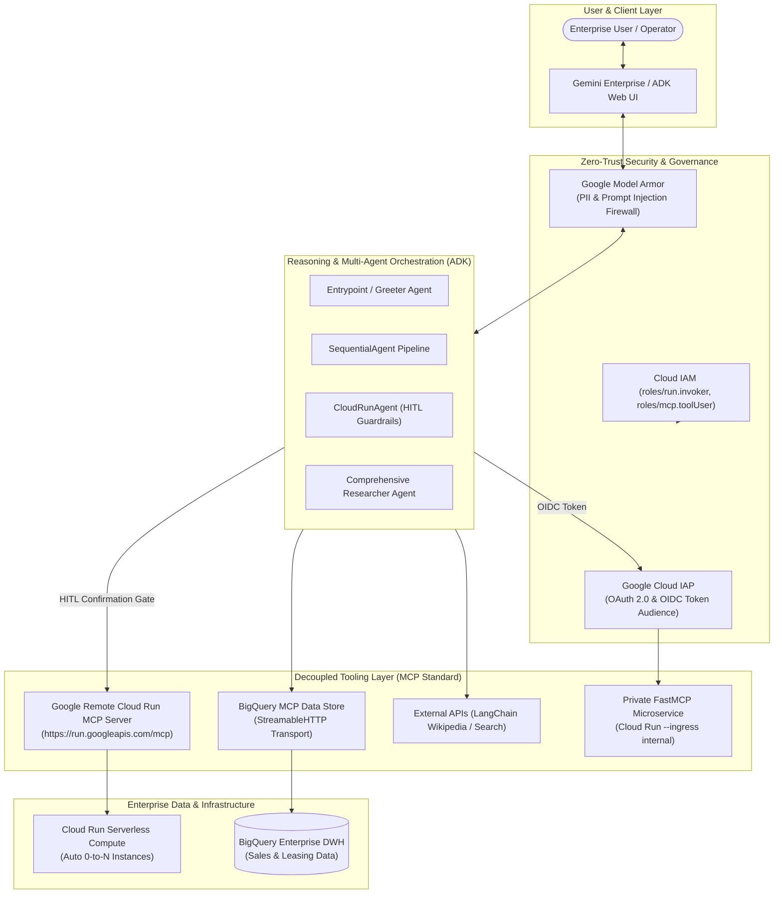

# Enterprise Agentic AI & Zero-Trust Cloud Architecture Portfolio

[-purple)](https://modelcontextprotocol.io/)

> **Enterprise Solution Accelerator & Engineering Showcase**: A production-ready portfolio of **Autonomous AI Agent Systems**, **Model Context Protocol (MCP) integrations**, **Zero-Trust Security architectures**, and **Conversational Data Warehouse Grounding** built on **Google Cloud Platform (GCP)** and **Vertex AI**.

---

## 📌 Executive Summary

Modern enterprise adoption of Generative AI requires transitioning from simple chat interfaces to **autonomous, secure, and tool-augmented multi-agent systems**. 

This repository demonstrates production-grade reference implementations solving the critical enterprise challenges of:
1. **Decoupled Architecture**: Separating reasoning layers from operational tooling layers via the open **Model Context Protocol (MCP)** standard.
2. **Zero-Trust Tool Governance**: Securing MCP servers on Google Cloud Run using **Identity-Aware Proxy (IAP)**, OIDC token audience claims, and private VPC ingress hardening.
3. **Conversational Data Grounding**: Enabling natural language SQL analytics over enterprise **BigQuery** data warehouses with user-delegated OAuth 2.0 permissions.
4. **DevOps Automation with Guardrails**: Autonomous infrastructure management via **Google Remote Cloud Run MCP** coupled with **Human-in-the-Loop (HITL)** approval gates for destructive mutations.
5. **Bilateral AI Security**: Intercepting prompt injections, sensitive data exposure, and toxic outputs using **Google Model Armor**.

---

## 🏛️ High-Level Enterprise Architecture

---

## 📂 Implementation Modules Catalog

| Module | Core Technologies | Architecture Pattern & Focus | Status |
| :--- | :--- | :--- | :---: |
| [**01. ADK Agent with Remote MCP Server**](./GCP/01-adk-mcp-cloudrun-agent/) | **Google ADK, FastMCP, Cloud Run, Vertex AI** | Decoupled Reasoning vs Tooling, Sequential Multi-Agent Orchestration, Serverless Autoscaling | ✅ Complete |
| [**02. Gemini Enterprise BigQuery MCP Data Store**](./GCP/02-gemini-enterprise-bigquery-mcp-datastore/) | **Gemini Enterprise, BigQuery, MCP StreamableHTTP, OAuth 2.0** | Zero-ETL Data Warehouse Grounding, Dynamic Tool Discovery, User-Delegated Security | ✅ Complete |
| [**03. Gemini Enterprise Model Armor & Workspace RAG**](./GCP/03-gemini-enterprise-workspace-model-armor/) | **Gemini Enterprise, Model Armor, Workspace RAG, Gemini 3.1 Pro** | Bilateral AI Security Firewall (Prompt Injection / PII Blocker), Multi-Source ACLs | ✅ Complete |
| [**04. Zero-Trust MCP Server on Cloud Run with IAP**](./GCP/secure-access-mcp-cloudrun-iap/) | **Cloud Run, Identity-Aware Proxy (IAP), FastMCP, VPC Ingress** | 4-Layer Defense-in-Depth for MCP Tools, Audience Validation, Network Hardening | ✅ Complete |
| [**05. Cloud Run Remote MCP Agent with HITL**](./GCP/cloud-run-remote-mcp-agent/) | **Google ADK, Google Remote MCP, Gemini, HITL Guardrails** | Autonomous Cloud Operations, Dynamic Tool Interception, Mutating Action Approvals | ✅ Complete |

---

## 🛡️ Core Enterprise Architectural Standards

### 1. Separation of Concerns (Reasoning vs. Tooling)
* LLM reasoning engines should never be tightly coupled to proprietary databases or internal APIs.
* By implementing the **Model Context Protocol (MCP)**, tool microservices maintain independent release cycles, monitoring, and scaling.

### 2. Zero-Trust Identity-Aware Defense-in-Depth
* MCP tool endpoints are never left exposed to the public internet.
* All tool calls require authenticated **OpenID Connect (OIDC) identity tokens** scoped to the target resource's OAuth Client ID (`aud` claim).
* Network ingress is locked down to `--ingress internal`, blocking unrouted public internet traffic at the perimeter.

### 3. Human-in-the-Loop (HITL) Execution Safety
* Autonomous agents operating against cloud infrastructure or enterprise records must not have unchecked write/delete permissions.
* Mutating keywords (`create`, `deploy`, `update`, `delete`) trigger mandatory `_require_confirmation = True` gates in the UI before actions execute.

### 4. Zero-ETL In-Place Data Grounding
* Avoids costly vector ingestion pipelines for tabular enterprise data.
* Natural language questions are converted into governed SQL queries evaluated directly inside BigQuery under the end user's IAM permissions.

---

## 🚀 Repository Navigation

Each module directory contains:
- **`README.md`**: Executive summary, system architecture diagrams, business use cases, and configuration parameters.
- **`lab_notes.md`**: Step-by-step reproduction playbook, command cheat sheet, and verified troubleshooting incident logs.
- **Application Code**: Production Python implementations (`agent.py`, `server.py`, `Dockerfile`, `requirements.txt`).
- **`docs/`**: Technical whitepapers detailing protocol mechanics, IAM flows, and sample enterprise query cookbooks.

---

## 🏢 Business Relevance for Enterprise Clients (WeWork)

* **Workplace Operations & Facilities**: Secure MCP tools managing desk allocations, HVAC scheduling, and access control with zero-trust auditability.
* **Tenant & Commercial Analytics**: Conversational reporting over lease renewals, occupancy rates, and billable services directly in BigQuery.
* **Self-Service DevOps Sandboxes**: Guardrailed AI agents deploying and managing ephemeral container workloads on Google Cloud Run.
